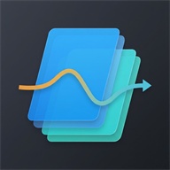

# PageFlow

**Le tue note sul telefono, come Notion — ma tutto resta sul telefono.**
Niente account, niente cloud: pagine, database e file sono salvati solo sul tuo dispositivo.

## Cosa puoi fare

- **Pagine e sottopagine** con testo, titoli, elenchi, caselle da spuntare, toggle, tabelle, citazioni, codice, immagini, video, audio e file
- **Database come Notion**: tabella, bacheca, calendario, timeline, elenco, galleria e grafici, con filtri, ordinamenti, raggruppamenti, formule e relazioni
- **Bottoni e automazioni** che fanno il lavoro ripetitivo da soli ("ogni lunedì crea la pagina della settimana")
- **Menzioni "@" e backlink**, e **blocchi sincronizzati**: lo stesso testo in più pagine, che cambia ovunque insieme
- **Promemoria e notifiche**, anche ripetuti
- **Scrivere a mano** e disegnare sopra le pagine, anche con la S Pen
- **Quaderni** in stile OneNote, con le loro sezioni
- **Registrare l'audio** e **scansionare documenti** con la fotocamera; la ricerca trova anche il **testo scritto dentro le foto**
- **Salvare dal web e dalle altre app**: web clipper, "Condividi" verso PageFlow, note al volo dal widget
- **Widget** nella barra laterale: meteo, risultati sportivi, borsa, orologi del mondo, conto alla rovescia, timer e pomodoro
- **Esportare** in PDF e Markdown, **backup** e cestino; **cronologia** di ogni pagina; pagine **bloccate** con password o impronta
- **Correttore ortografico** in 5 lingue; l'app è in 8 lingue (italiano, inglese, tedesco, francese, spagnolo, cinese, coreano, giapponese)

## Installazione

Scarica l'APK dall'ultima [Release](https://github.com/AbernathyXVII/PageFlow/releases) e aprilo sul telefono (Android 8.0 o più recente).
Al primo avvio l'app è vuota: trovi una sola pagina, "My Space", da cui cominciare.

## Privacy

I tuoi dati restano sul telefono, a meno che tu non li esporti o ne faccia un backup altrove. Internet serve solo alle funzioni che ne hanno bisogno, come i widget (meteo, sport, borsa), le anteprime dei link, i video di YouTube, il web clipper e i modelli di Google Play Services per lo scanner e per leggere il testo delle foto, che poi lavorano sul telefono.

## Tutte le novità

La storia completa, versione per versione, è nel [README completo](https://github.com/AbernathyXVII/PageFlow/blob/main/README.md).
